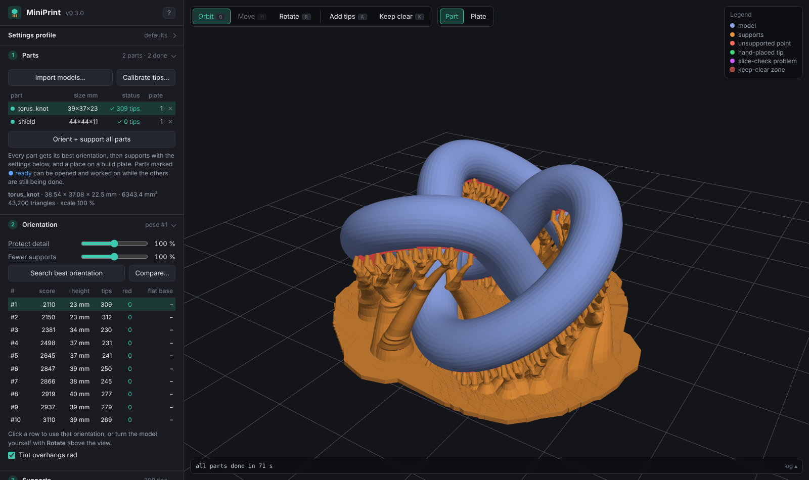
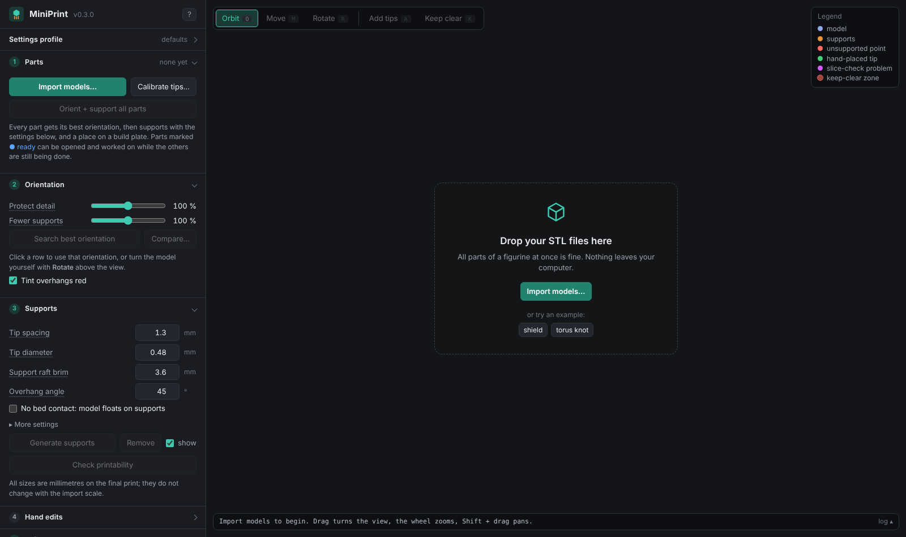
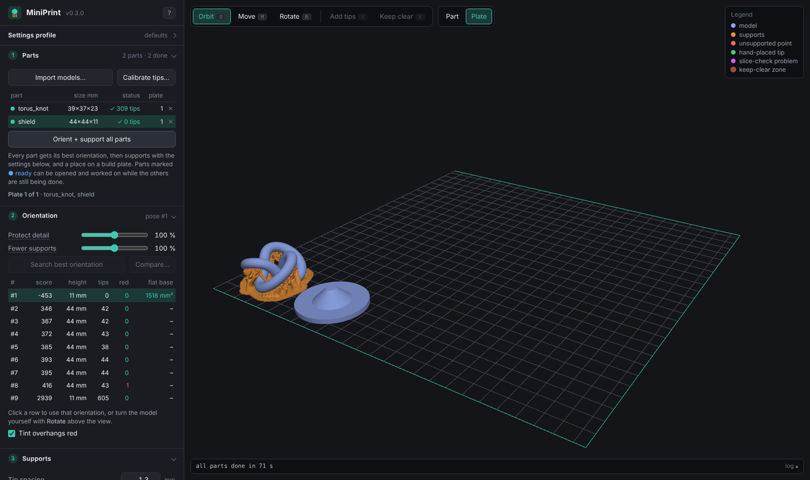

# MiniPrint

**Free, open-source print preparation for miniatures and figurines on FDM printers.** MiniPrint finds a good
print orientation for every part, grows smooth tree supports with small, resin-style contact tips, arranges all
parts on your build plates and exports ready-to-slice 3MF files (tested with Bambu Studio; any slicer that
reads 3MF or STL works).

Everything runs on your own computer. The app opens in your web browser, but nothing is uploaded anywhere.

**[⬇ Download for Windows](https://github.com/danunachas/MiniPrint/releases/latest/download/MiniPrint-windows-x64.zip)** – unzip, double-click `MiniPrint.exe`, done. No installation, no account.
Linux / macOS: [Docker](#docker-linux-macos-home-server) or [Python](#any-system-with-python).

## Download and start

### Windows (no installation)

1. Download [`MiniPrint-windows-x64.zip`](https://github.com/danunachas/MiniPrint/releases/latest/download/MiniPrint-windows-x64.zip)
   (also on the [Releases](../../releases) page) and unzip it anywhere (Desktop, Documents, a USB stick…).
2. Double-click **`MiniPrint.exe`**. A small console window opens and MiniPrint appears in your browser. Closing
   the console window stops MiniPrint.

Windows may warn that the app is from an unknown publisher (it is not code-signed): click *More info → Run
anyway*. If you only have the bare `MiniPrint.exe` from the source code, its first start downloads MiniPrint's
own Python runtime (about 60 MB, once) into the `runtime` folder next to it.

### Docker (Linux, macOS, home server)

    docker run -d --name miniprint -p 127.0.0.1:8765:8765 -v miniprint-data:/data ghcr.io/danunachas/miniprint

then open <http://127.0.0.1:8765/>. Details, `docker compose` and use from other devices:
[docs/docker.md](docs/docker.md).

### Any system, with Python

1. Install Python 3.10 or newer from [python.org](https://www.python.org/downloads/) (Windows: tick
   *Add python.exe to PATH*).
2. Download the source (*Code → Download ZIP*) and unzip it.
3. `python -m pip install -r requirements.txt`, then `python -m miniprint.gui` in the MiniPrint folder
   (opens http://127.0.0.1:8765/). On Windows you can also double-click `MiniPrint.pyw`.

A browser with WebGL2 is needed (any current Chrome, Edge, Firefox or Safari).

No model at hand? The start screen offers the two models in [`examples/`](examples) (made for MiniPrint, free
to use).

## Workflow

1. **Import models…** – choose or drop all STL files of your figurine at once. In the import window set
   * **Scale** (100 % = as in the file; 120 % makes a 28 mm figure about 34 mm),
   * **Keep triangles** – sculpts often have far more triangles than an FDM print can show; 20–40 % is usually
     invisible on the print and makes everything much faster. The mesh stays watertight either way.
2. **Orient + support all parts** – first every part gets its best orientation, then supports; each part is
   put on a build plate as soon as its supports are done. The page stays usable meanwhile: the dot in the parts
   list shows where each part is (grey = waiting, orange = being worked on, **blue = ready** – oriented, you
   can open it and work on its supports now, green = done). A part you open and change while the batch runs is
   left to you.
3. **Check and adjust** – click a part in the list to work on it alone:
   * pick another orientation from the table (*Compare picture* shows them side by side), or turn it yourself
     with the **Rotate** tool (drag a ring: red X, green Y, blue Z; 5° steps),
   * **Remove supports** to start over, change settings, **Generate supports** again,
   * **Add tips** / **Keep clear** (tools above the view) to force or forbid contact points,
   * **Check printability** slices the result virtually and marks anything that would print in mid-air.
   * **Part / Plate** above the view switches between working on one part and seeing a whole build plate.
4. **Build plates** – choose your printer's plate size and press **Arrange on plates**. Long parts are laid
   diagonally when that is the only way they fit. Every part is always visible: parts without a spot yet
   (still waiting for supports, or too big even when turned) wait in a row beside the plate. In the plate view
   the **Move** and **Rotate** tools place parts by hand – also from that row onto the plate; parts that touch
   or stick out over the edge are named in red. Parts beside the plate are not exported.
5. **Export all plates (3MF)** – one 3MF per plate (several plates come as one ZIP). Every part is one object
   made of two parts, *model* and *supports*.

Mouse: drag turns the view, Shift-drag (or the middle button) pans, the wheel zooms. Keys: `O` `M` `R` `A` `K`
pick the tools above the view, `Ctrl+Z` undoes a hand edit, `Esc` goes back to Orbit. Hover over the name of
any setting for an explanation; **?** at the top of the side panel shows a short guide.

## Settings profiles

All settings are remembered between starts. **Save as…** stores them under a name (e.g. "X1C 0.2 nozzle PLA";
saving under an existing name updates that profile), the drop-down switches between them, **↺** next to it goes
back to the default settings, and **Export… / Import…** writes or reads a `.miniprint-profile.json` file, so you
can share good settings for a printer or filament, or keep backups.
Profiles live in `presets.json` in the MiniPrint folder. Ready-made and community profiles are in
[`profiles/`](profiles) – contributions welcome.

## Calibrate support tips

**Calibrate support tips…** (under *Import models*) adds a set of small test pieces to the project. Each piece is a
small bar that floats above the plate on its supports (5 mm by default): its **flat underside** is the 90°
overhang and one end is a **45° slope**. Each piece is supported with one combination of **tip diameter**
(rows, back to front) and **tip penetration** (columns, left to right). The default is 0.36–0.60 mm tips in
0.04 mm steps × 0.1 / 0.2 / 0.3 / 0.4 mm penetration = 28 pieces (made for a 0.2 mm nozzle; edit the lists for
other nozzles). The values are raised on top of every piece in hundredths of a millimetre (**t48** = 0.48 mm
tip, **P20** = 0.20 mm penetration) and are part of the object names in the 3MF. Everything else (spacing,
no bed contact, …) uses your current settings, so set those first. The grid gets a plate of its own; on a
small plate it is split into blocks of whole rows and columns over several plates.

After printing, compare the pieces: did every tip hold while printing (no sagging or loose strands under the
flat underside), do the supports snap off cleanly, and how big are the marks on the slope and the underside?
Enter the best piece's two values in *Supports* (*Tip penetration* is under *More settings*) and save them in a
profile. Typical outcome:
tips too thin or too shallow fall off or fail to bond; too thick or too deep are hard to remove and leave pits.

## Supports at a bigger layer height (slicer tip)

Layer height is set per object in the slicer. To print the supports faster than the miniature:

1. Import the 3MF, right-click the part and choose **Split → To objects** (Bambu Studio / Orca).
2. Give the *supports* object a bigger layer height (e.g. 0.16 mm) and keep the *model* fine (e.g. 0.06 mm).

A slicer puts every new object down onto the plate, so a model that floats above its supports (no bed contact)
would drop. MiniPrint therefore adds a tiny 2 × 2 × 0.4 mm **anchor block** to a floating model: it sits on the
plate directly under the model, inside the support raft, so it is printed as part of the raft (no separate
square to scrape off the plate) and keeps the model exactly in place after splitting. It changes nothing if you
do not split, so it is always added.
Bambu Studio then shows two orange warnings (“conflicts of gcode paths” – the tips reach into the model on
purpose – and “empty layer” for the model object); neither stops the print.

## Support settings in short

| setting | default | what it does |
|---|---|---|
| Tip spacing | 1.3 mm | distance between contact points (smaller = more tips, less sagging) |
| Tip diameter | 0.48 mm | contact point size – find yours with *Calibrate support tips* |
| Support raft brim | 3.6 mm | how far the support raft under each trunk reaches beyond its foot (grip on the plate) |
| Overhang angle | 45° | surfaces facing down more steeply than this get supports |
| No bed contact | off | the model floats 3 mm above one support raft that joins all trunks |
| *More settings:* | | |
| Tip penetration | 0.24 mm | how deep the tip reaches into the model – also from the calibration |
| Branch diameter | 0.8 mm | thinnest branch behind a tip |
| Cone angle | 4° | how fast branches thicken towards the plate (stability of tall supports) |
| Merge range | 12 mm | how far branches lean to join each other |
| Max branch lean | 40° | steepest sideways lean of a branch |
| On build plate only | on | supports never stand on the model (off: as a last resort where nothing reaches the plate) |
| Join support rafts closer than | 3.6 mm | neighbouring rafts closer than this become one |
| Big flat faces stand on the plate | on | a part with a flat face of at least 40 mm² (a base, the back of a shield, a cut face) is turned with that face down and stands on it – no supports or marks there, shorter print, best grip – also with no bed contact |

Every generated support is slice-checked: MiniPrint slices the result virtually and adds tips wherever material
would start in mid-air, then generates again.

All support sizes are in millimetres of the final print; they do not change with the import scale.

## Command line

    python -m miniprint model.stl                       best orientation + supports -> output\model\
    python -m miniprint model.stl --scale 1.2 --raft
    python -m miniprint --help                          every option

Output: `<name>_supported.3mf` (model + supports as one object), `_model.stl`, `_supports.stl`, a preview
picture, the ranked orientations (`--pick N` uses another one) and a report.

## Development

    python -m pip install -e ".[dev]"
    python -m pytest                                    the tests
    ruff check .                                        the linter
    python tools/run_corpus.py <folder with STL files>  run everything on a folder of models, summary table

[docs/architecture.md](docs/architecture.md) explains how the code is organised;
[CONTRIBUTING.md](CONTRIBUTING.md) how to send changes. The Windows launcher is in [`launcher/`](launcher)
(Go, standard library only); the GitHub workflows build the Windows download and the Docker image for every
release.

## Good to know

* Printing has not been validated on every printer: check the first print of a new setup, especially tall
  trunks and the contact tips. Raise *Tip diameter* if tips break off, lower it if marks are too big.
* Very large parts (over ~500k triangles kept) take minutes for orientation and supports; reduce on import.
* Parts with a lot of overhang (long coats, wings) can need more support material than the model itself –
  MiniPrint warns, and such parts often print better split into pieces.
* MiniPrint never changes your slicer settings; the 3MF carries geometry only.

## License

MiniPrint is free software: you can redistribute it and/or modify it under the terms of the
[GNU General Public License v3.0](LICENSE) or (at your option) any later version. It comes with ABSOLUTELY NO
WARRANTY.

The Windows download also contains Python (PSF License), numpy and scipy (BSD licenses) and Pillow (MIT-CMU
license); their license files are inside the `runtime` folder.
